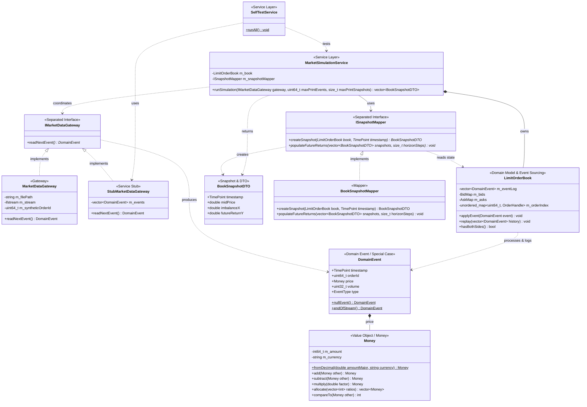

# High-Performance Limit Order Book (LOB) Engine & Microstructure Feature Pipeline

A deterministic, low-latency **Limit Order Book (LOB)** matching engine and market microstructure feature extraction pipeline written in modern **C++**.

Developed as part of quantitative and statistical market microstructure research (**Hierarchical Correlation Reconstruction — HCR**) under the supervision of **Prof. Jarosław Duda** at **Jagiellonian University** (*Uniwersytet Jagielloński w Krakowie*).

---

## Key Engineering Highlights

* **Strict Price-Time Priority (FIFO) Matching Engine:** Full support for passive limit order queuing, aggressive spread-crossing sweeps across multiple price levels, partial fills, in-place volume reductions, price-level modifications, and cancellations.
* **$O(1)$ Order Lifecycle & Top-of-Book Metrics:** Iterator-caching hash index (`std::unordered_map<uint64_t, OrderHandle>`) enables $O(1)$ order cancellation, $O(1)$ in-place modification, and $O(1)$ top-of-book aggregated volume retrieval without scanning order queues.
* **Zero-Allocation CSV Hot-Path Ingestion:** Custom pointer-based parser (`std::strtod` / `std::strtoll` over a pre-reserved line buffer) processes **665,000+ NASDAQ ITCH / LOBSTER events in ~0.7s** on a single thread while automatically reconstructing aggressive spread-crossing orders from execution messages.
* **Enterprise Architecture (Martin Fowler's PoEAA):** Clean separation of concerns across ingestion gateways, domain models, event sourcing logs, snapshot mappers, data transfer objects (DTOs), and application service layers.
* **Sanitizer-Verified Memory Safety:** Zero heap leaks, zero undefined behavior, and strict warning-free compilation (`-Wall -Wextra -Werror`) verified under **AddressSanitizer (ASan)** and **UndefinedBehaviorSanitizer (UBSan)**.

---

## Enterprise Architecture & Design Patterns

The codebase strictly adheres to **Martin Fowler's *Patterns of Enterprise Application Architecture (PoEAA)*** and **Domain-Driven Design (DDD)** principles to keep the matching core decoupled from I/O and statistical analysis modules:

| Pattern (Martin Fowler) | Component / Header | Architectural Responsibility |
| :--- | :--- | :--- |
| **Money & Value Object** | [`include/Money.hpp`](include/Money.hpp) | Exact 64-bit integer fixed-point monetary representation (`int64_t` cents), currency-mismatch guards, and remainder-preserving proportional allocation (`allocate()`) with zero floating-point rounding drift. |
| **Domain Event & Special Case** | [`include/DomainEvent.hpp`](include/DomainEvent.hpp) | Immutable representation of standardized market events (`BUY`, `SELL`, `MODIFY`, `CANCEL`) paired with `nullEvent()` and `endOfStream()` Special Case factories to eliminate null-pointer checks on the hot path. |
| **Separated Interface** | [`include/IMarketDataGateway.hpp`](include/IMarketDataGateway.hpp)<br>[`include/ISnapshotMapper.hpp`](include/ISnapshotMapper.hpp) | Pure abstract contracts decoupling the engine and service layer from concrete data sources and feature-extraction formulas. |
| **Gateway** | [`include/MarketDataGateway.hpp`](include/MarketDataGateway.hpp) | Encapsulates external LOBSTER CSV streaming and translates exchange execution records (`Type 4`) into synthetic aggressive `BUY`/`SELL` domain orders so the matching engine executes all fills end-to-end. |
| **Service Stub** | [`include/IMarketDataGateway.hpp`](include/IMarketDataGateway.hpp) | `StubMarketDataGateway` provides deterministic in-memory event streams for isolated unit testing without file system I/O. |
| **Domain Model & Event Sourcing** | [`include/LimitOrderBook.hpp`](include/LimitOrderBook.hpp) | Core matching engine maintaining bid/ask price trees, FIFO queues, an $O(1)$ `OrderHandle` index, an append-only audit log (`m_eventLog`), and full deterministic state reconstruction via `replay()`. |
| **Data Transfer Object (DTO)** | [`include/BookSnapshotDTO.hpp`](include/BookSnapshotDTO.hpp) | Lightweight, logic-free transport structure carrying extracted microstructure features (`timestamp`, `midPrice`, `imbalanceX`, `futureReturnY`) to downstream statistical analyzers. |
| **Mapper** | [`include/BookSnapshotMapper.hpp`](include/BookSnapshotMapper.hpp) | Translates `LimitOrderBook` domain state into `BookSnapshotDTO` records in $O(1)$ time without polluting the order book with statistical logic. |
| **Service Layer** | [`include/MarketSimulationService.hpp`](include/MarketSimulationService.hpp)<br>[`include/SelfTestService.hpp`](include/SelfTestService.hpp) | Defines the application boundary, orchestrating data ingestion, order book state transitions, periodic DTO snapshot extraction, and automated invariant self-tests. |

---

## UML Class Diagram

The full interactive UML Class Diagram (including a PlantUML export version) is maintained in **[`UML_CLASS_DIAGRAM.md`](UML_CLASS_DIAGRAM.md)**.



---

## Algorithmic Complexity & Data Structures

| Operation | Complexity | Implementation Details |
| :--- | :---: | :--- |
| **Best Bid / Best Ask Lookup** | $O(1)$ | Cached tree extremes via `m_bids.begin()` (`std::map` with descending comparator) and `m_asks.begin()`. |
| **Order Cancellation (`CANCEL`)** | $O(1)$ amortized | Direct lookup via `m_orderIndex` (`std::unordered_map<uint64_t, OrderHandle>`) storing stable `std::list` and `std::map` iterators; $O(\log L)$ only when the last order at a price level is erased. |
| **In-Place Volume Reduction (`MODIFY`)** | $O(1)$ amortized | Direct iterator dereference via `OrderHandle` updates both order volume and `PriceLevel::totalVolume` in $O(1)$. |
| **Limit Order Insertion** | $O(\log L)$ | $L$ is the number of active price levels (`std::map::emplace` + $O(1)$ `std::list::push_back`). |
| **Snapshot Feature Extraction (`DTO`)** | $O(1)$ | Reads top-of-book prices and pre-aggregated `PriceLevel::totalVolume` directly from `begin()` iterators without traversing order queues. |

### Microstructure Feature Definitions (`BookSnapshotDTO`)

At every configured sampling interval where both sides of the book are populated, `BookSnapshotMapper` computes:

1. **Mid-Price ($M_t$):**
   $$M_t = \frac{P_{\text{bid}, 1}(t) + P_{\text{ask}, 1}(t)}{2}$$
2. **Top-of-Book Order Imbalance ($X_t \in [-1, 1]$):**
   $$X_t = \frac{V_{\text{bid}, 1}(t) - V_{\text{ask}, 1}(t)}{V_{\text{bid}, 1}(t) + V_{\text{ask}, 1}(t)}$$
3. **Future Mid-Price Return ($Y_t$ over horizon $k$):**
   $$Y_t = M_{t + k} - M_t$$

---

## Repository Structure

```text
LOB_engine/
├── include/
│   ├── Money.hpp                    # Fixed-point Money Value Object
│   ├── DomainEvent.hpp              # Standardized Domain Event & Special Cases
│   ├── IMarketDataGateway.hpp       # Separated Interface & in-memory Service Stub
│   ├── MarketDataGateway.hpp        # Fast CSV Gateway & LOBSTER Type-4 re-indexer
│   ├── LimitOrderBook.hpp           # FIFO Matching Engine & Event Sourcing core
│   ├── BookSnapshotDTO.hpp          # Data Transfer Object for statistical features
│   ├── ISnapshotMapper.hpp          # Separated Interface for snapshot extraction
│   ├── BookSnapshotMapper.hpp       # O(1) Domain-to-DTO Mapper
│   ├── MarketSimulationService.hpp  # Service Layer coordinating simulation pipeline
│   └── SelfTestService.hpp          # Diagnostic Service Layer running unit tests
├── main.cpp                         # Clean application entry point
├── UML_CLASS_DIAGRAM.md             # Full Mermaid & PlantUML class diagrams
└── README.md
```

---

## Building, Running & Sanitizer Verification

### Prerequisites
* **Compiler:** `clang++` (macOS / Linux) or `g++` supporting C++14 / C++20.

### 1. Release / Performance Build
```bash
clang++ -std=c++20 -Wall -Wextra -Werror -O3 -Iinclude main.cpp -o lob_engine
./lob_engine
```

### 2. Strict Sanitizer Build (ASan + UBSan)
```bash
clang++ -std=c++20 -Wall -Wextra -Werror -fsanitize=address,undefined -g -Iinclude main.cpp -o lob_test
./lob_test
```

### Sample Output (LOBSTER NASDAQ Dataset)
```text
=== Money Value Object Tests ===
Money Value Object & Exact Allocation tests: PASSED

=== LimitOrderBook, Service Stub & Snapshot Mapper Tests ===
FIFO, Partial Fill, Full Sweep & Modify via Service Layer + Stub: PASSED
Event Sourcing State Replay test: PASSED
BookSnapshotDTO & Mapper test: PASSED ([Snapshot t=0.00s | midPrice=99.50 | imbalanceX=0.50 | futureReturnY=0.00])
Order Cancel & Empty Book cleanup test: PASSED

=== LOBSTER MarketSimulationService (Service Layer) ===
Reading from: ../MSFT_data/MSFT_message.csv
... (665139 more events processed)
Simulation finished in 715.58 ms | Total logged events: 665149 | Captured snapshots: 6651 | Active resting orders: 4329
Final Best Bid: 30.13 USD (vol: 50626) | Final Best Ask: 30.14 USD (vol: 16600)
```
