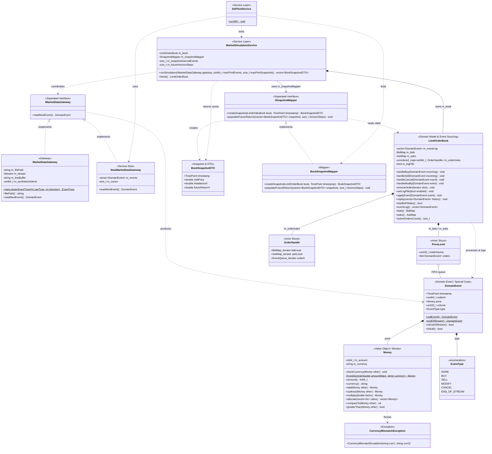
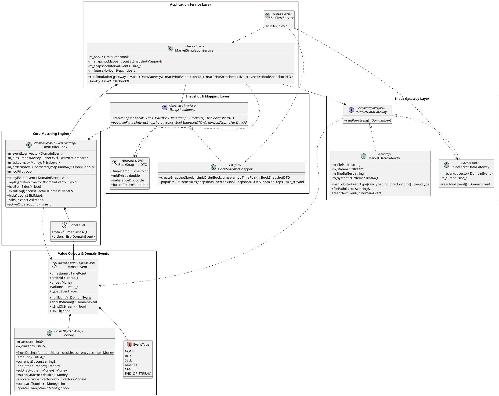

# UML Class Diagram — LOB Matching Engine & Snapshot Pipeline

This diagram reflects the **strict UML static dependency and ownership relationships** (who depends on / `#include`s whom) across the currently implemented codebase, structured around Martin Fowler's *Patterns of Enterprise Application Architecture (PoEAA)*.

> **Note:** GitHub renders the Mermaid diagram below natively. As new modules (such as `IAnalyzerPlugin`, `HCRCorrelationAnalyzer`, and `Registry`) are added, this diagram is updated alongside the code.

## Legend of UML Relationships

| Symbol | Relationship | Meaning in C++ Code |
| :--- | :--- | :--- |
| `A <\|.. B` | **Realization (Implementation)** | Class `B` inherits from and implements pure virtual interface `A`. |
| `A *-- B` | **Composition** | `A` owns `B` by value; `B`'s lifetime is strictly bound to `A`. |
| `A o-- B` | **Aggregation** | `A` holds a collection of `B` elements (`std::list<DomainEvent>`). |
| `A --> B` | **Directed Association** | `A` holds a reference or pointer to `B` (`const ISnapshotMapper&`). |
| `A ..> B` | **Dependency** | `A` `#include`s `B` and uses it as a method parameter or return type (`B` has no knowledge of `A`). |

<b>Click to expand PlantUML source code (for Draw.io / PlantText export)</b>

